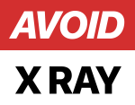

# Branding

  
  &nbsp;
  

## Name

**AvoidXray**: one word, capital A and capital X, everything else lowercase.

| Where | Write |
|---|---|
| Prose, UI, titles | AvoidXray |
| The domain in text | AvoidXray.com |
| All-caps settings (export edge print, slide mounts) | AVOIDXRAY |
| Handles | @avoidxray |

Not "Avoid X Ray", "Avoid XRay", "AvoidXRay" or "AVOIDXRAY.COM". URLs in code
and links stay lowercase (`https://avoidxray.com/...`), since that is what the
browser shows anyway.

## Logo

The logo reads AVOID on a red block and X RAY on a second block. The lettering
is drawn as paths, so the files need no font.

| File | Shape | Use |
|---|---|---|
| `public/logo.svg` | Wide, 307×56, white second block | On dark backgrounds: the site header, footer and watermarks |
| `public/logo-inverted.svg` | Wide, 307×56, black second block | On light backgrounds |
| `public/logo-mark.svg` | Stacked, 150×117 | Where a square-ish mark fits better than a wide one |
| `public/favicon/` | Square | Browser tabs and home screen icons only |
| `public/logo-email.png` | Raster | Email, where clients block SVG |

Use the files as they are. Don't recolor the blocks, set the name in a font
next to the mark, or stretch it. On a photo, the watermark renderer handles
placement and contrast, so use that instead of placing the logo by hand.

## Color

| Token | Hex | Use |
|---|---|---|
| `brand` | `#D32F2F` | The logo, primary buttons, focus outlines |
| `brand-dark` | `#B71C1C` | Primary button hover |
| `brand-light` | `#EF5350` | Small red text on the dark page, where `brand` is too dark to read |
| `success` | `#2E7D32` | Confirmations |
| page | `#0a0a0a` | The site background |

Everything else is the neutral gray scale. Red is for the mark and for the one
action that matters on a screen, so it keeps its weight.

## Type

- **Inter** for text
- **Inter Tight** for headings
- **JetBrains Mono** for ids, numbers that need to line up and code
- **Kalam** only for the handwritten caption style in exports

## Writing

- US English.
- Sentence case for buttons, headings and labels: "Upload photos", not "Upload Photos".
- Say what happened and what to do next. "Could not save the photo. Try again."
- No em dashes, no exclamation marks, no emoji in the UI.
- No hype ("iconic", "legendary") and no filler ("just", "really", "actually").
- Catalog entries follow [docs/writing-standard.md](docs/writing-standard.md).
